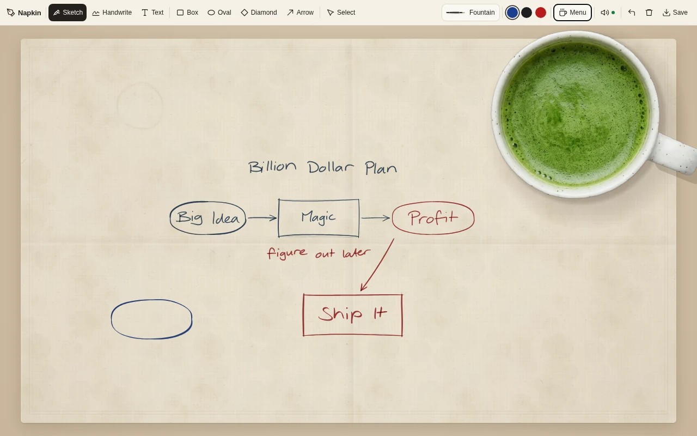

# Napkin Sketch

A browser-first, zero-dependency digital café paper napkin for organic sketching and real-time neural handwriting. Draw rough shapes that snap into designer-grade vector ink, drag live hand-sketched boxes and arrows, type directly onto the paper in streaming cursive, choose real top-down pens with velocity-matched paper foley, order a coffee or matcha from the café menu, and crumple finished sheets away with 3D physics.


## Quick Start

No Python ML libraries, build steps, or GPU required—serve the repository locally and open the app:

```bash
python3 -m http.server 8765
```

Then open **`http://localhost:8765/`** (or **`http://localhost:8765/index.html`**) in your browser.



## Features

- **Smart Sketch (`S`) & Live Dynamic Shapes (`B`, `O`, `D`, `A`):** Freehand single- or multi-stroke drawings (600 ms debounce, 97.2% circle/box/diamond accuracy) auto-beautify into organic shapes and arrows using a 21k-param OpenSketch `(dx, dy, pressure)` Residual VAE with construction under-sketches. Dragging explicit shape or arrow tools renders deterministic hand-drawn ink dynamically as you draw—no dashed preview boxes and zero jump on release.
- **Direct Handwrite (`H`) & Live On-Napkin Typing (`T`):** Single-click anywhere on the napkin or inside any shape to type directly on the paper without a floating input box. Hand-written `4.9 KB` WebAssembly SIMD128 (`graves_v5.wasm`) streams cursive words in parallel Web Workers (`~30–55 ms`) with per-word caching across 4 writing styles (_Clean Upright_, _Designer Cursive_, _Crisp Print_, _Fast Journal_).
- **Combined Pen & Handwriting Style Menu:** Declarative Popover + Invoker Commands picker pairing 5 photo-segmented top-down pens (_Ballpoint Pen_, _2B Graphite Pencil_, _Felt-Tip Marker_, _Fountain Nib_, _0.5mm Mechanical_)—each with node-free single-fill ink ribbons and matched velocity-sensitive Web Audio foley—alongside live WASM-synthesized handwriting preview cards.
- **Café Drink Menu & Unclipped 3× Interactive Mug:** Starts drink-free with a prominent **Menu** button (_"Get caffeinated for better ideas"_). Order _Coffee Latte_, _Black Coffee_, _Ceremonial Matcha_, or _Matcha Latte_ (replaces any existing drink). The 3× top-down cup renders on an unclipped full-stage overlay so the mug and handle overhang napkin edges naturally onto the café table. Click to drink (lifted off-napkin with decreasing volume `100% → 65% → 30% → 5%` and direct `0% → 100%` refill when empty), or press-and-hold to lift, move, and rotate with rigid-body torque.
- **Smooth Programmatic Stains & Companion Audio:** Continuous-ribbon capillary cup rings plus randomly placed drips and multi-drop trails across the napkin (gated on drawing interaction or repeated mug moves) pair with a single toolbar Sound On/Off toggle driving velocity-matched pen audio, ceramic mug set-down foley, probabilistic brainstorming vocals (_ooo_, _aha_, _hmm_, _mm_, _eureka_, _oops_ on drips), and an exasperated grunt on non-empty sheet crumples.
- **Random Starter Diagrams:** Refreshes load one of 10 lighthearted, abstract café-napkin diagrams (_Billion Dollar Plan_, _Coffee Loop_, _Weekend Plan_, _Cat Logic_, _Brainstorm Funnel_, etc.) without repeating back-to-back.
- **Select, Move, Resize & Delete (`V`):** Drag any shape, arrow, handwritten burst, or text block, resize via 4 corner handles (regenerating crisp OpenSketch strokes on release), double-click to edit labels, or press `Backspace`/`Delete` to remove.
- **Procedurally Unique Paper Napkins & Staged 3D Crumple Toss:** Every fresh sheet has its own warm kraft/ecru/linen tone, seamless embossed texture (`dimple`, `linen`, `diamond`, `pinpoint`), embossed café border, tilted quarter-folds, corner creases, and natural pulp flecks. Clicking the trash icon first lifts any drink completely off the napkin, then crumples the sheet into a 3D faceted paper ball synced to `web/crumble.mp3`, tosses it off-screen, and sets the mug back down onto a fresh sheet.
- **Export (`Save`):** Download either a **2× HiDPI PNG** or an **editable Vector SVG**—both preserving the full textured napkin background, dried drink stains, and node-free `multiply`-blended ink.

## Keyboard Shortcuts

| Shortcut               | Action                       |
| :--------------------- | :--------------------------- |
| `S` / `H` / `T`        | Sketch / Handwrite / Text    |
| `B` / `O` / `D` / `A`  | Box / Oval / Diamond / Arrow |
| `V` (or `M`)           | Select, Move & Resize        |
| `Backspace` / `Delete` | Delete selected item         |
| `Ctrl+Z` / `Cmd+Z`     | Undo                         |
| `Enter` / `Escape`     | Commit / Cancel active text  |

## Architecture & Files

| Component                      | Files                                                                                                                                                                                                | Details                                                                                                                                                                                                |
| :----------------------------- | :--------------------------------------------------------------------------------------------------------------------------------------------------------------------------------------------------- | :----------------------------------------------------------------------------------------------------------------------------------------------------------------------------------------------------- |
| **Latest App**                 | `index.html`, `web/hw_worker_v5.js`, `web/crumble.mp3`                                                                                                                                               | Root single-file HTML/Canvas/Web Audio app (promoted from `v9`) with unclipped cup overlay, declarative Popover menus, parallel Web Worker pool, and Cache API asset persistence.                      |
| **Companion SFX & VFX Assets** | `web/sfx/*.mp3` (14 clips), `docs/vfx/cups/*.webp` (16 sprites), `docs/vfx/pens/*.webp` (5 sprites)                                                                                                  | Curated ElevenLabs vocal/foley clips plus Gemini + SAM 3.1 segmented transparent top-down drink (4 drinks × 4 volumes) and pen sprites.                                                                |
| **Exploration Boards**         | `web/soundboard.html`, `docs/vfx-board.html`                                                                                                                                                         | Minimal standalone sandboxes for auditioning all 8 procedural pen surfaces, Speed Test Pad, SFX cadence, cup assets, and programmatic stains.                                                          |
| **Designer Stroke VAE**        | `exports/opensketch_residual_vae.json` (`433 KB`)                                                                                                                                                    | Trained on 24,541 real Wacom strokes from 15 industrial designers (**OpenSketch**, CC0) for `(rx, ry, pressure)` residuals.                                                                            |
| **Streaming Cursive WASM**     | `exports/handwriting/graves_v5.wasm` (`4.9 KB`), `graves_v5.bin` (`4.05 MB`), `graves_v5_meta.json`                                                                                                  | Hand-written WAT SIMD128 (`src/graves_v5.wat`) with sparse character-column skipping, `f32x4` LSTM gates, INT8 quantized weights, 4-char primed attention states, and delayed crossbar/dot completion. |
| **Version Archive**            | `web/v1_napkin.html` (originally `index.html`), `web/v2_napkin.html`, `web/v3_draw.html`, `web/v4_draw.html`, `web/v5_napkin.html`, `web/v6_napkin.html`, `web/v7_napkin.html`, `web/v8_napkin.html` | Preserved historical milestones from the initial browser ML proof-of-concept through v8.                                                                                                               |

## Rebuilding WASM (Optional)

```bash
wat2wasm src/graves_v5.wat -o exports/handwriting/graves_v5.wasm
```

## Documentation

- [Iteration Report (v1 → Latest)](docs/report.md)
- [Soundboard Explorer](web/soundboard.html)
- [VFX Cup & Stain Board](docs/vfx-board.html)

## Data Licenses

- **OpenSketch** (Inria): CC0
- **IAM-OnDB pretrained handwriting weights** (`Rybib/rytability-magic-handwriting` / `sjvasquez/handwriting-synthesis`): research/non-commercial terms of IAM-OnDB apply.
