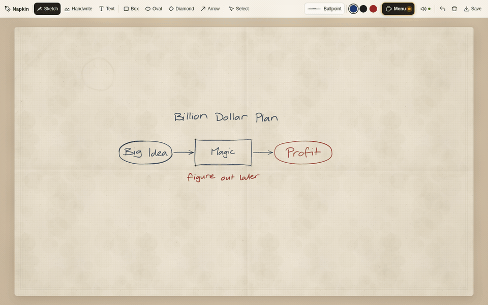

# Napkin

Back-of-the-napkin sketching for your next big idea—with organic hand-drawn shapes, streaming cursive handwriting, realistic pens, and a café drink menu.



## Features

- **Smart Sketch (`S`) & Shape Tools (`B`, `O`, `D`, `A`):** Sketch rough shapes freehand and let them auto-beautify into clean hand-drawn boxes, circles, diamonds, and arrows—or use the explicit shape and arrow tools to draw them directly.
- **Handwriting (`H`) & On-Napkin Typing (`T`):** Click anywhere on the napkin or inside a shape to type directly onto the paper in real-time cursive across 4 styles (_Clean Upright_, _Designer Cursive_, _Crisp Print_, _Fast Journal_).
- **5 Pens & Sound Effects:** Switch between _Ballpoint Pen_, _2B Graphite Pencil_, _Felt-Tip Marker_, _Fountain Pen_, and _0.5mm Mechanical_ in the pen/style menu, with velocity-matched paper foley and an optional toolbar sound toggle.
- **Café Drink Menu & Interactive Mug:** Open **Menu** to order _Coffee Latte_, _Black Coffee_, _Ceremonial Matcha_, or _Matcha Latte_. Click the mug to take a sip (or refill when empty), or press-and-hold to move and rotate it around the napkin and table—leaving occasional cup rings and drips.
- **Select, Edit & Starter Diagrams (`V`):** Move or resize any shape, arrow, or text block, double-click to edit labels, or refresh for a new randomized starter diagram on a procedurally textured paper napkin.
- **Crumple & Export:** Toss finished sheets away with a 3D crumple animation, or click **Save** to export a **2× PNG** or **Vector SVG** with the paper texture, stains, and ink intact.

## Keyboard Shortcuts

| Shortcut               | Action                       |
| :--------------------- | :--------------------------- |
| `S` / `H` / `T`        | Sketch / Handwrite / Text    |
| `B` / `O` / `D` / `A`  | Box / Oval / Diamond / Arrow |
| `V` (or `M`)           | Select, Move & Resize        |
| `Backspace` / `Delete` | Delete selected item         |
| `Ctrl+Z` / `Cmd+Z`     | Undo                         |
| `Enter` / `Escape`     | Commit / Cancel active text  |

## Development

The app is built with **Vite** and **TypeScript** (`index.html` + `src/app/`).

### Prerequisites

- Node.js and npm

### Commands

```bash
npm install          # Install dependencies (Vite, TypeScript)
npm run dev          # Start the local Vite dev server
npm run typecheck    # Run TypeScript type checking (tsc --noEmit)
npm run build        # Typecheck and build production bundle to dist/
npm run preview      # Preview the production dist/ build locally
```

### Project Layout

- `index.html`, `src/app/` — Main TypeScript application (`main.ts`, `ink-vae.ts`, `handwriting.ts`, `hw-worker.ts`, `cup.ts`, `crumple.ts`, `napkin-paper.ts`, `audio.ts`, `assets.ts`, `starters.ts`, `styles.css`).
- `vite.config.ts`, `tsconfig.json` — Vite build configuration (`base: "/napkin/"`) and TypeScript settings.
- `.github/workflows/deploy.yml` — Automated GitHub Pages build and deploy on pushes to `master`.
- `exports/` — Pre-trained model weights (`opensketch_residual_vae.json`, `handwriting/graves_v5.*`).
- `web/` & `docs/` — Audio/SFX clips, cup & pen sprites, exploration boards ([Soundboard](web/soundboard.html), [VFX Board](docs/vfx-board.html)), and the [Iteration Report](docs/report.md).

## Model Training

Pre-trained model artifacts are already committed under `exports/`, so training is only needed if you want to retrain or re-export the models. The Python training scripts require **PyTorch** and **NumPy** (and **Pillow** for `train_glyph_vae.py`).

> **Note:** The Python scripts default `DATA_DIR` / `OS_DIR` / `EXPORT_DIR` to `/home/antigravity/napkin-ml/...`. Update those path constants at the top of the scripts if your local dataset or output directory differs.

### 1. OpenSketch Stroke Residual VAE (Active)

Learns human trajectory residuals `(rx, ry)` and stylus pressure `p` from 24,541 real Wacom strokes in the **OpenSketch** (Inria, CC0) dataset, and exports decoder-only JSON weights for browser inference:

```bash
python3 src/train_opensketch_residuals.py
```

Outputs `exports/opensketch_residual_vae.json` and `exports/opensketch_residual_vae.pt`.

### 2. Streaming Handwriting Synthesis (Active)

Quantizes the pretrained Graves (2013) IAM-OnDB LSTM weights (`exports/handwriting/hand_synth.bin` + `hand_synth.json`) into INT8 sparse/dense blocks with primed writer states, paired with the hand-written WebAssembly SIMD128 kernel:

```bash
python3 src/test_handwriting.py          # Verify baseline forward pass
python3 src/export_v5_graves.py          # Export graves_v5.bin + graves_v5_meta.json
wat2wasm src/graves_v5.wat -o exports/handwriting/graves_v5.wasm  # Optional: rebuild WASM
```

### 3. Auxiliary & Exploratory Models

Earlier prototype models can also be retrained from Quick, Draw! / OpenSketch data:

```bash
python3 src/fetch_data.py                # Download Quick, Draw! stroke subsets
python3 src/train_gesture_classifier.py  # -> exports/gesture_mlp.json
python3 src/train_stroke_generator.py    # -> exports/stroke_gru_mdn.json
python3 src/train_glyph_vae.py           # -> exports/glyph_vae.json
```

### Data Licenses

- **OpenSketch** (Inria): CC0
- **IAM-OnDB pretrained handwriting weights** (`Rybib/rytability-magic-handwriting` / `sjvasquez/handwriting-synthesis`): research/non-commercial terms of IAM-OnDB apply.
