# Napkin Sketch — Iteration Report (v1 → v7)

A concise technical log of iterating **Napkin Sketch** from an initial dual-pane browser ML demo (`v1`) to a tactile, distraction-free, zero-dependency napkin sketching app (`v7`).

---

## Iteration Timeline

| Version | Primary Focus | Key Milestone |
| :--- | :--- | :--- |
| **v1** | Browser ML proof of concept | 39k-param Quick, Draw! Sketch-GRU MDN + 68-feature Gesture MLP in pure JS |
| **v2** | Real designer ink + cursive | OpenSketch `(dx, dy, pressure)` Residual VAE + pure-JS FP32 IAM-OnDB handwriting (~14–29 s) |
| **v3** | Direct-draw interactive canvas | Single-canvas Smart Sketch auto-beautify + `<1 ms` OpenSketch-ink lettering |
| **v4** | Fast neural handwriting A/B/C | Per-Char Glyph-VAE (`1.3 ms`) + C-compiled WASM SIMD128 INT8 cached cursive (`~218–357 ms`) |
| **v5** | 60 FPS streaming cursive & UX | `4.8 KB` hand-written WAT SIMD128 + parallel Web Workers (`~11 ms` first ink) + 500 ms multi-stroke Smart Sketch |
| **v6** | Tactile kraft napkin & live typing | Textured paper napkin, ballpoint ink, minimalist icon toolbar, single-click live word-cached typing, writing styles |
| **v7** | Final polish, audio & root fixes | 97.2% circle/box recognizer, resize & delete, unique procedural napkins, napkin-only typing, Web Audio Sound Board, synced 3D crumple throw, fixed `f`/`t`/`i` strokes, PNG+SVG export |

---

## Training Datasets & Learned Features

Rather than using pixel diffusion or hand-coded sine-wave jitter, Napkin Sketch learns organic stroke kinematics and handwriting styles directly from three real-world vector datasets, then applies those learned features in compact browser models:

### 1. OpenSketch (Inria, CC0) → Designer Stroke Residuals & Stylus Pressure
- **What's in the dataset:** `24,541` real Wacom stylus strokes (`(x, y, pressure, t)`) drawn by `15` professional industrial designers across concept and presentation sketches.
- **What we learned (`opensketch_residual_vae.json`, `21k` decoder params):** Each stroke is aligned into a canonical chord frame `(0,0) → (1,0)` over `K=32` arc-length steps and decomposed into perpendicular/tangential human trajectory residuals `(ru, rv)` plus the real stylus pressure profile `p(t)` (`start 0.173 → mid 0.405 → lift 0.154`), conditioned on `[is_curved, is_presentation, norm_log_len]`.
- **How it's applied:** Every box, oval, diamond, and arrow on the napkin is rendered in two learned passes—a light *Concept* construction under-sketch (`is_pres = 0.0`) beneath firm, pressure-tapered *Presentation* ink (`is_pres = 0.75`).

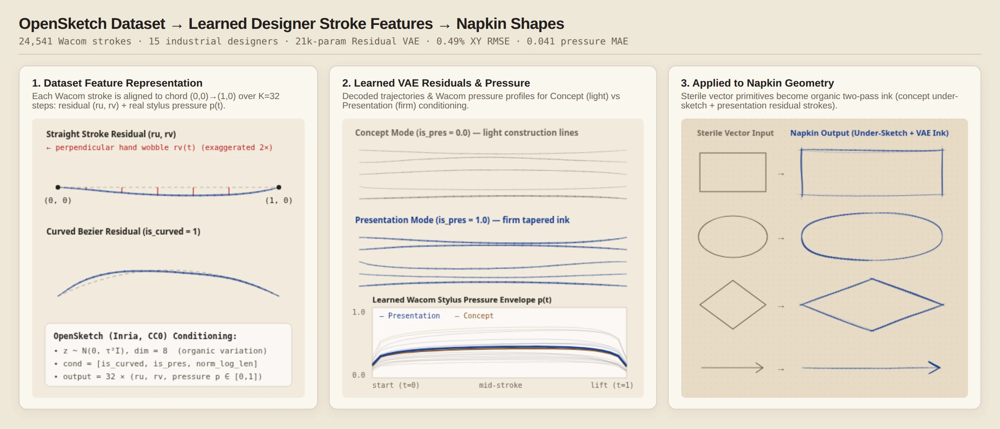

### 2. IAM-OnDB → Real Human Writer Styles in Streaming WASM
- **What's in the dataset:** Online stylus handwriting trajectories `(dx, dy, eos)` recorded from real human writers on a whiteboard/tablet, including `13` writer style priming sequences (`386–881` pen steps each).
- **What we learned & deployed (`graves_v5.wasm`, `4.9 KB` + `4.05 MB` INT8):** A 3-layer LSTM with 10-component Gaussian attention and 20-component bivariate MDN captures each writer's slant, ligatures, letterforms, and pen-lift rhythm. Pre-computing exact 4-char primed attention states transfers a writer's style onto any typed text in `~30–55 ms` via parallel Web Workers.

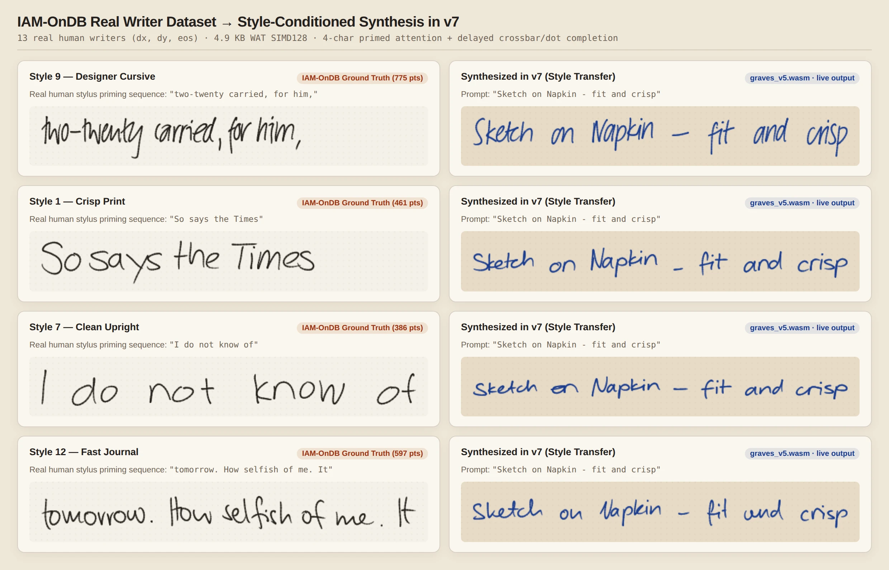

### 3. Why We Evolved Beyond Quick, Draw! (v1 → v2+)
- **What's in the dataset (`v1`):** `7,114` crowd-drawn Quick, Draw! vector primitives (`square`, `circle`, `diamond`, `triangle`, `line`) without pressure channels.
- **Takeaway:** While the 39k-param Sketch-GRU MDN converged cleanly (`-1.3746` test NLL over 24 epochs), crowd-drawn shapes drifted at corners and lacked stylus pressure—directly motivating the move to OpenSketch designer stroke residuals in `v2–v7`.

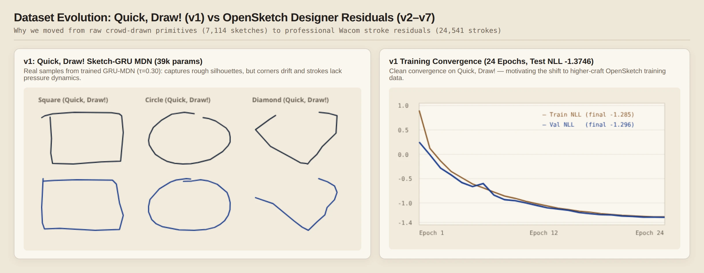

---

## v1 — Live Browser Inference Studio

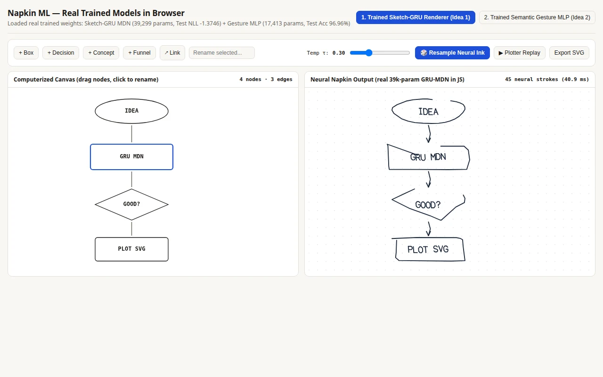

- **Goal:** Prove non-diffusion vector sketch generation could run entirely in the browser with sub-1 MB models.
- **Implementation:** Split-pane canvas (`Computerized Canvas → Neural Napkin Output`) powered by a 39k-param Conditional Sketch-GRU MDN trained on Quick, Draw! primitives (`-1.3746` test NLL) and a 68-feature Gesture MLP (`96.96%` test acc).
- **Takeaway:** Fast (`~40 ms`) and editable, but Quick, Draw! shapes were wobbly and labels were rigid block glyphs.

---

## v2 — OpenSketch Residual Ink & IAM-OnDB Handwriting

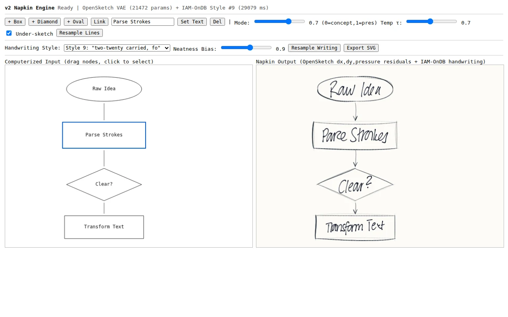

- **Goal:** Replace cartoon Quick, Draw! wobble with authentic industrial-designer line work and real human cursive.
- **Implementation:** Trained a 21k-param `DesignerStrokeResidualVAE` on 24,541 real Wacom strokes from OpenSketch (`(rx, ry, pressure)` residuals + faint construction under-sketches) and ported Graves (2013) IAM-OnDB handwriting (`14.5 MB` FP32) to pure JS.
- **Takeaway:** Visual quality jumped dramatically, but uncached pure-JS priming + LSTM synthesis took `14–29 s` per scene—far too slow for interactive typing.

---

## v3 — Interactive Direct-Draw Napkin

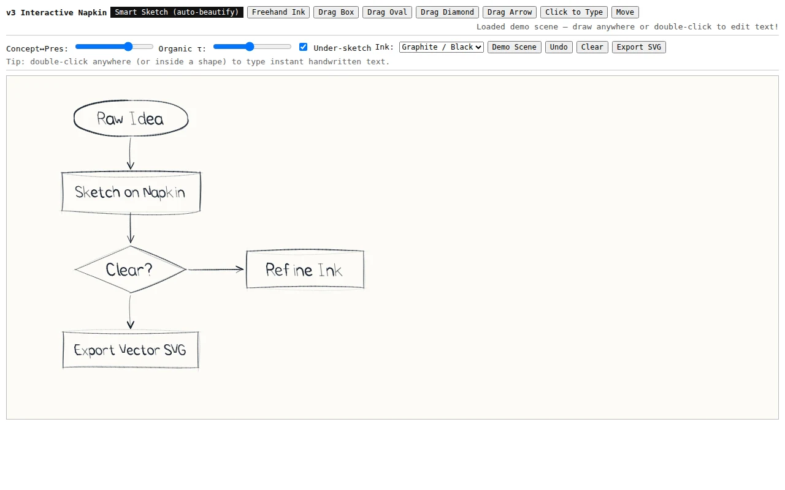

- **Goal:** Collapse the two-pane node editor into a direct-manipulation sketching surface.
- **Implementation:** Introduced Smart Sketch (freehand strokes auto-beautified into boxes, ovals, diamonds, and arrows using OpenSketch residuals), Freehand ink, and `<1 ms` OpenSketch-ink lettering so typing felt instantaneous.
- **Takeaway:** Interaction felt natural, but `<1 ms` single-stroke lettering lacked the organic flow of true neural cursive.

---

## v4 — Fast Handwriting Benchmark (Method A vs B vs C)

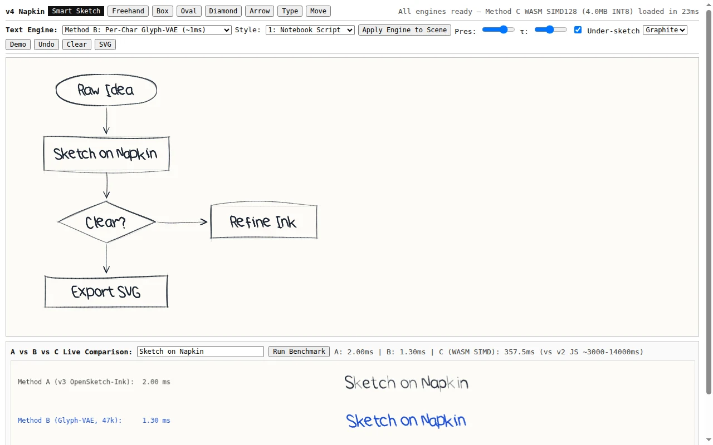

- **Goal:** Bridge the `14,000×` latency gap between `<1 ms` lettering and `14 s` neural cursive.
- **Implementation:** Built a live 3-engine benchmark comparing:
  - **Method A:** `<1 ms` OpenSketch-ink baseline.
  - **Method B:** 47k-param non-autoregressive Per-Char Conditional Glyph-VAE (`1.3 ms`, `299 KB`, 6 styles).
  - **Method C:** Pre-cached primed states (eliminating 70–78% of steps) + per-row INT8 quantization (`4.0 MB`) compiled to `clang` WASM SIMD128 in a Web Worker (`~218–357 ms`, `65×` faster than v2).
- **Takeaway:** Method C preserved full Graves cursive authenticity at interactive latency, pointing to further optimization for real-time typing.

---

## v5 — Hand-Written WAT SIMD128 & Multi-Stroke Smart Sketch

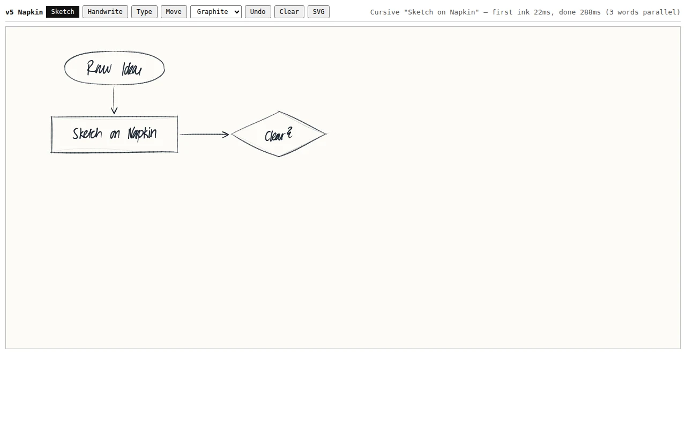

- **Goal:** Make real Graves cursive feel instantaneous while simplifying the UI.
- **Implementation:** Rewrote the Graves engine in hand-tuned WebAssembly Text (`graves_v5.wat` → `4.8 KB` `.wasm`) with sparse character-column skipping (~97% of 73 char columns skipped), vectorized `f32x4` LSTM gates, parallel word Web Workers, and 28-step 60 FPS ink streaming (`~11–22 ms` to first ink). Upgraded Smart Sketch to a 500 ms multi-stroke debounce plus a Direct Handwrite tool.
- **Takeaway:** Dramatic speed and layout improvement, though aggressive priming/stopping shortcuts later surfaced subtle legibility regressions on `f`/`t`/`i` strokes.

---

## v6 — Textured Kraft Napkin & Live Word-Cached Typing

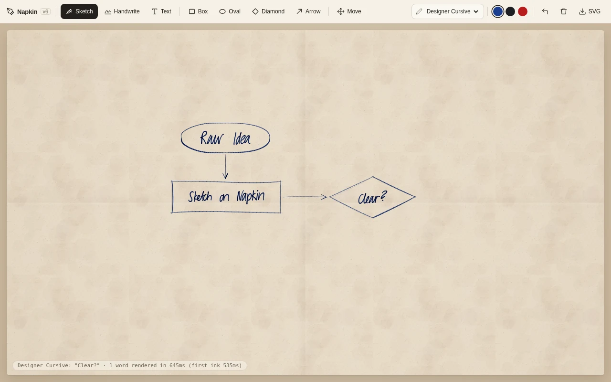

- **Goal:** Elevate the visual craft into a believable physical paper napkin with effortless typing.
- **Implementation:** Added procedural light-brown textured kraft paper, ballpoint blue/black/red `multiply`-blended ink, a minimalist icon toolbar with explicit shape tools (`Box`, `Oval`, `Diamond`, `Arrow`), 600 ms multi-stroke debounce, unified writing styles (*Designer Cursive*, *Crisp Print*, *Clean Upright*, *Fast Journal*), Cache API asset persistence, and single-click live per-keystroke typing with per-word caching.
- **Takeaway:** Looked and felt close to a finished product, revealing remaining rough edges: circle-vs-box misclassifications, no resize/delete in Select mode, a floating secondary input pill during typing, static identical napkins, and silent interactions.

---

## v7 — Final State

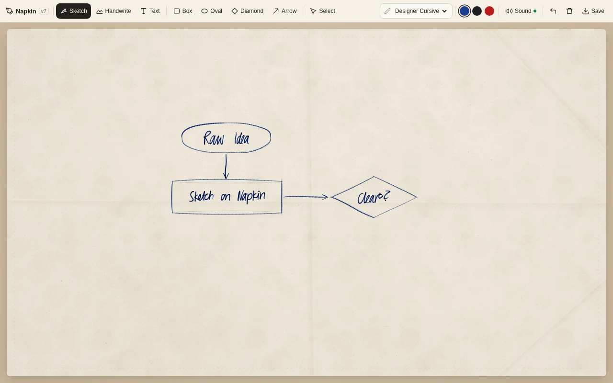

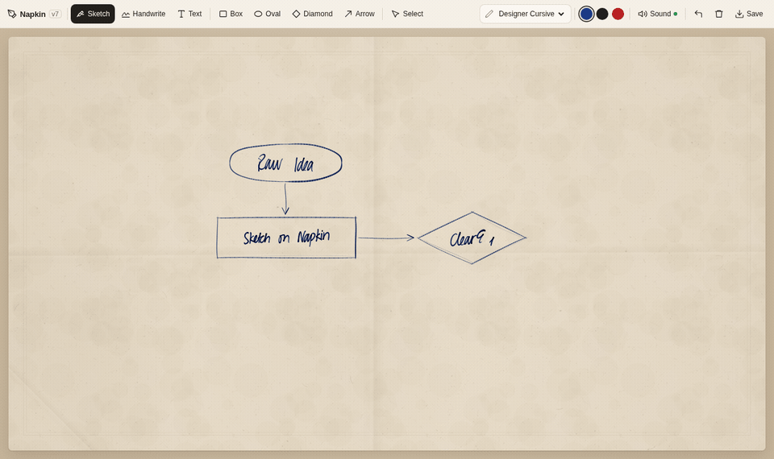

### Key Improvements Over v6
- **Accurate Shape Recognition & Editing:** Replaced squared-radius heuristics with a uniform arc-length Euclidean radial metric + cornerness check (lifting circle-vs-box accuracy from `34.8%` to `97.2%`). Upgraded `Select` with 4 corner resize handles, crisp OpenSketch stroke regeneration on release, and `Backspace`/`Delete`. Removed the bottom status pill for a distraction-free canvas.
- **Direct Napkin-Only Text Editing:** Eliminated the floating secondary input box. Typing renders directly on the napkin with a subtle baseline guide or dashed shape focus cue, trailing-space and arrow-key aware blinking ink caret, and selection highlight—backed by an invisible IME/keyboard focus proxy.
- **Procedurally Unique Napkins:** Each napkin (on load and after every toss) generates a unique sheet across 6 warm kraft/ecru/linen palettes, 4 seamless `320×320` embossed textures (`dimple`, `linen`, `diamond`, `pinpoint`), varied embossed borders, tilted off-center quarter-folds, diagonal corner creases, non-repeating pulp flecks, and an occasional subtle coffee-cup ghost ring—cached once per sheet for 60 FPS drawing.
- **Tactile Web Audio & Sound Board:**
  - **Velocity-Matched Drawing SFX:** 8 procedural multi-layer Web Audio surface presets (*Ballpoint Pen*, *2B Graphite Pencil*, *Felt-Tip Marker*, *Fountain Nib*, *Chalk / Charcoal*, *Soft Ink Brush*, *0.5mm Mechanical*, *ASMR Kraft Napkin*) whose filter cutoffs, embossed paper-grain `playbackRate`, loudness, curvature grit, and pen-down tap dynamically track pointer speed (and fall silent when paused), plus optional cadence-matched typing pen SFX and a collapsible **Sound Board** with an interactive Speed Test Pad.
  - **Synced 3D Crumple & Toss:** Clicking Clear captures the current napkin—with or without content—and plays a 3D faceted affine-textured paper-ball crumple choreographed directly to `./crumble.mp3`'s two-squeeze acoustic envelope (`0–445 ms` initial gather, `445–555 ms` regrip lull, `555–940 ms` final tight crush, `920–1420 ms` ballistic toss), revealing a fresh unique napkin underneath.
- **Handwriting Root-Cause Fix (`f`/`t` Bars & `i` Dots):** Diagnosed and fixed four v5 inference/rendering regressions without retraining: restored exact 4-char primed `tail_texts` and `kappa - (P - 4)` alignment, added delayed back-stroke tracking in `graves_v5.wat` (`4.9 KB`) so word-final `t`/`f` crossbars and `i`/`?`/`!` dots finish before stopping on the forward word-space jump, restored `dkMult = 1.00` and balanced bias (`0.94–0.98`), and preserved 1-point dots with firm ink taper in `layoutWordsToStrokes()`.
- **Full-Background Export:** Added a `Save` menu exporting both **2× HiDPI PNG** and **editable Vector SVG** (embedding the full textured napkin sheet beneath `multiply`-blended vector ink strokes).
